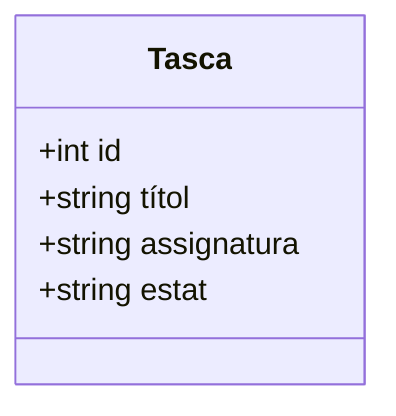

# SPECIFICATIONS.md — Sistema Tasks_app (v1.0)

## 1. Visió General
Tasks_app és una eina CLI lleugera per ajudar als estudiants a gestionar les seves tasques acadèmiques diàries.

## 2. User Stories (Històries d'Usuari)
- US-01: Com a estudiant, vull afegir una tasca amb títol i assignatura per recordar els meus deures.
- US-02: Com a estudiant, vull veure la llista de tasques pendents per organitzar el meu temps.

## 3. Model de Dades (Mermaid)

## 4. Requisits
- RF-01 : El sistema tasks_app ha de guardar les tasques en un fitxer JSON de persistència local.
- RF-02 : Si el fitxer `data/tasks.json` no existeix, el sistema tasks_app ha de crear `data/tasks.json`  inicialitzat amb una llista JSON buida ([])
- RF-03 : El sistema tasks_app ha de proveir a l'estudiant la capacitat de crear una nova tasca amb estat 'pendent' mitjançant el comandament add --title <títol> --subject <assignatura>.
- RF-04: El sistema tasks_app ha de proveir a l’estudiant la capacitat de visualitzar totes les tasques registrades (incloent-hi el seu ID, títol, assignatura i estat) mitjançant el comandament list.

## 5. Criteris d’acceptació i proves (Gherkin scenarios)
- GS-01: Creació correcta d'una tasca
  Atès que la base de dades JSON no conté encara tasques
  quan l’estudiant executa `python src/tasks_app.py add --title 'Pràctica 1' --subject 'RS'
  aleshores el sistema confirma `Tasca [ID: 1] creada amb èxit`
  i la tasca queda registrada al fitxer `data/tasks.json`.

- GS-02: Llistat de tasques quan `data/tasks.json` no conté registres 
  Atès que la base de dades JSON no conté encara tasques
  quan l’estudiant executa `python src/tasks_app.py list`
  aleshores el sistema mostra `Registre de tasques buit.` 

- GS-03: Llistat de tasques quan data/tasks.json conté registres
  Atès que el fitxer `data/tasks.json` conté les següents tasques:
    | id | títol          | assignatura | estat   |
    | 1  | Pràctica 1     | RS          | pendent |
    | 2  | Examen parcial | SO          | pendent |
  quan l’estudiant executa `python src/tasks_app.py list`
  aleshores el sistema mostra per pantalla:
    "[1] Pràctica 1 (RS) - estat: pendent"
    "[2] Examen parcial (SO) - estat: pendent".

- GS-04: Creació automàtica del fitxer JSON quan no existeix
  Atès que el fitxer data/tasks.json no existeix prèviament
  quan l’estudiant executa python src/tasks_app.py list
  aleshores el sistema crea el fitxer data/tasks.json amb el contingut [] i mostra Registre de tasques buit.

- GS-05: Assignació incremental d'ID en afegir múltiples tasques
  Atès que el fitxer data/tasks.json ja conté la tasca:
    | id | títol      | assignatura | estat   |
    | 1  | Pràctica 1 | RS          | pendent |
  quan l’estudiant executa python src/tasks_app.py add --title 'Laboratori 2' --subject 'BD'
  aleshores el sistema confirma Tasca [ID: 2] creada amb èxit
  i el fitxer data/tasks.json conté ambdues tasques preservant la primera.

- GS-06: Nou ID quan l'ID més alt existent no és correlatiu
  Atès que el fitxer data/tasks.json conté les tasques amb ID 1 i 5
  quan l’estudiant executa python src/tasks_app.py add --title 'Treball final' --subject 'PW'
  aleshores el sistema assigna l'ID 6 a la nova tasca
  i confirma Tasca [ID: 6] creada amb èxit.

- GS-07: Error en crear una tasca sense arguments obligatoris
  Atès que l’estudiant executa python src/tasks_app.py add --title 'Pràctica sense assignatura' quan el sistema processa els arguments aleshores finalitza amb un codi de sortida diferent de zero
  i no modifica ni corromp el fitxer data/tasks.json.

- GS-08: Gestió de fitxer JSON mal format o corrupte
  Atès que el fitxer data/tasks.json conté JSON no vàlid (per exemple {json_invalid) quan l’estudiant executa python src/tasks_app.py list aleshores el sistema informa d'un error de lectura/format i finalitza amb un codi de sortida diferent de zero.